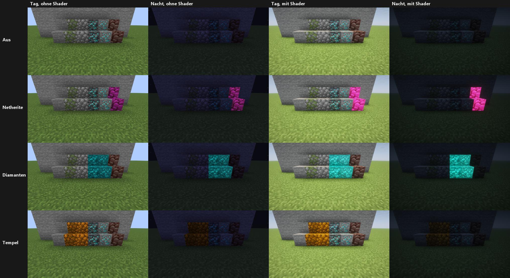
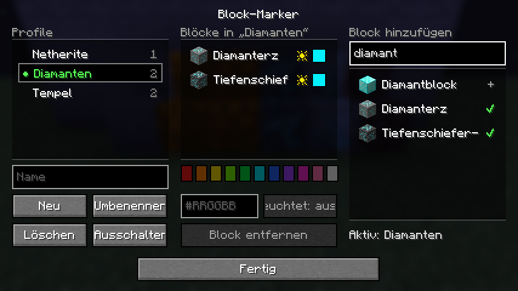

# Block-Marker

Fabric-Client-Mod für **Minecraft 26.3**. Sie färbt gewählte Blöcke kräftig ein und lässt sie auf Wunsch leuchten (voll hell, auch im Dunkeln). Das Muster des Blocks bleibt erkennbar. Die Blöcke stehen in Profilen, die man per Taste durchschaltet.

**Kein X-Ray:** Die Mod ändert nur, wie ein Block *aussieht*. Nichts wird durchsichtig, nichts leuchtet durch Wände, es gibt keinen Erzsucher. Einen Block, den man nicht sieht, sieht man auch mit Block-Marker nicht. Ein Server-Teil existiert nicht.



## Bedienung

| Taste (Standard) | Aktion |
|---|---|
| **,** (Komma) | nächstes Profil, nach dem letzten wieder aus |
| **.** (Punkt) | angeschauten Block ins aktive Profil aufnehmen, noch einmal drücken nimmt ihn wieder heraus (nur in normaler Reichweite) |
| – (frei belegbar) | Block-Marker-Menü öffnen |

Das Menü öffnet man über **Mod Menu → Block-Marker → Einstellungen** oder über die frei belegbare Taste:

- **Profile:** anlegen, umbenennen, löschen, ein- oder ausschalten (Doppelklick)
- **Blöcke im Profil:** Farbe aus knalligen Vorgaben oder als eigener Farbcode (`#RRGGBB`), Schalter „Leuchtet“
- **Block hinzufügen:** Suche nach Namen in der Spielsprache (auch Deutsch) oder nach ID, mit Vorschau-Icon

Vorgefertigte Profile: **Netherite** (Ancient Debris), **Diamanten** (Diamant- und Tiefenschiefer-Diamanterz), **Tempel** (Bruchstein, bemooster Bruchstein). Beim ersten Start ist Block-Marker aus.



Die Einstellungen liegen in `config/blockmarker.json`.

## Wie es funktioniert

Block-Marker meldet ein unsichtbares Resourcepack an, das immer ganz oben liegt. Für jeden Block des aktiven Profils überschreibt es nur dessen `blockstates`-Datei und verweist auf Kopien der Modelle mit **getönten Kopien der Texturen**, die aus den darunterliegenden Packs gelesen werden. Eigene Resourcepacks und Server-Packs funktionieren also mit. „Leuchtet“ setzt an den Modell-Elementen `light_emission: 15`. Nach einer Änderung lädt das Spiel die Resourcepacks neu (wie F3+T), bei schnellem Durchschalten nur einmal.

Treppen, Stufen usw. mit derselben Textur bleiben unverändert. Blöcke ohne normales Modell (z. B. Truhen, Schilder) lassen sich nicht einfärben.

## Kompatibilität

Getestet mit Sodium 0.9.2 und Iris 1.11.7, mit und ohne Complementary-Reimagined-Shader. Einfärben und Leuchten funktionieren in beiden Fällen. Benötigt Fabric API, Mod Menu ist optional.

## Entwickeln

Benötigt JDK 25.

```
./gradlew test               # Farblogik, Profile, Pack-Generator
./gradlew build              # Jar in build/libs/
./gradlew runClientGameTest  # Test-Client mit Sodium + Iris, Screenshots in build/block-marker-screenshots/
```

Für den Test-Client einmal den Shader herunterladen (siehe `testumgebung/LIESMICH.md`).

## Lizenz

MIT
